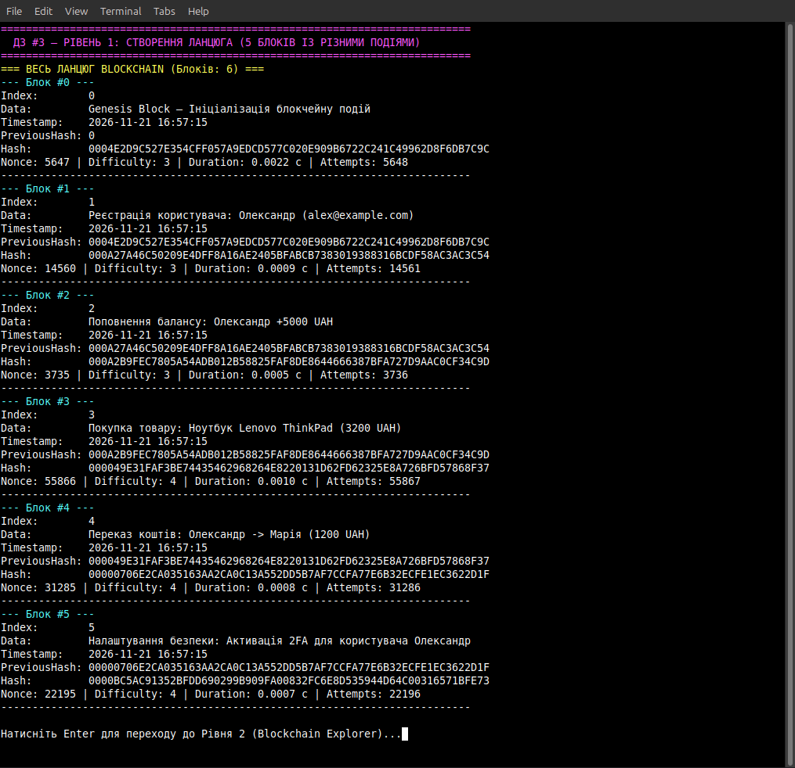
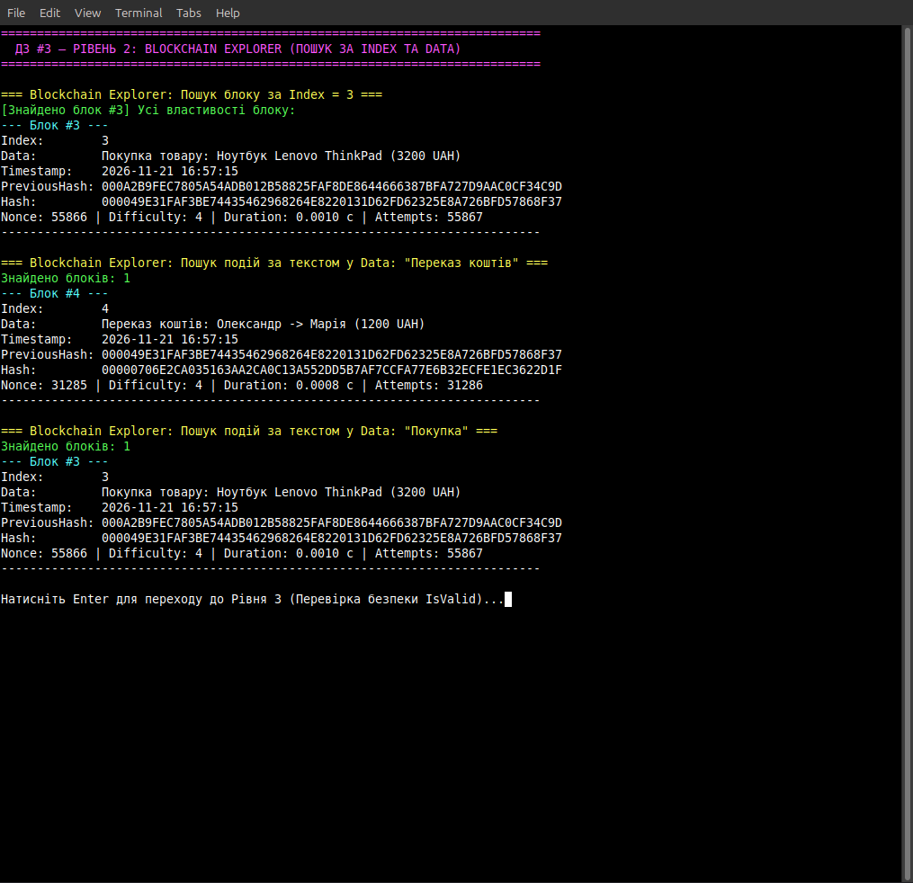
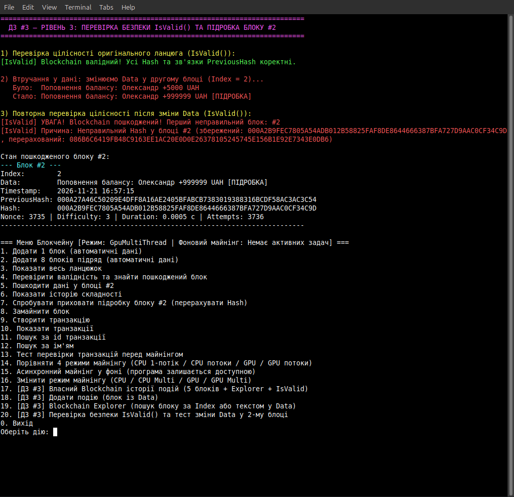

# ДЗ №3 — Власний Blockchain для збереження історії подій

Реалізація простого блокчейну для збереження історії подій на базі навчального проєкту `BlockChainP33` (C# / .NET 10) із підтримкою **Blockchain Explorer** та **перевірки безпеки `IsValid()`**.

---

## Реалізований функціонал

### Рівень 1. Створення ланцюга
- Додано поле `Data` (а також сумісні властивості `Timestamp` і `PreviousHash`) у клас [`Block`](../Block.cs), яке бере участь в обчисленні SHA-256 хешу у [`HashingService`](../HashingService.cs) та в усіх 4 режимах майнінгу [`MiningService`](../MiningService.cs).
- Реалізовано метод `AddEventBlock(string data)` у [`BlockChain`](../BlockChain.cs), який створює блок із полями `Index`, `Data`, `Timestamp`, `PreviousHash` та `Hash`.
- Створено ланцюг із Genesis-блоком та **5 блоками з різними подіями**:
  1. `Реєстрація користувача: Олександр (alex@example.com)`
  2. `Поповнення балансу: Олександр +5000 UAH`
  3. `Покупка товару: Ноутбук Lenovo ThinkPad (3200 UAH)`
  4. `Переказ коштів: Олександр -> Марія (1200 UAH)`
  5. `Налаштування безпеки: Активація 2FA для користувача Олександр`
- Весь ланцюг виведено у консоль через `DisplayService.DisplayChain()`.

### Рівень 2. Blockchain Explorer
- Реалізовано методи пошуку у [`BlockChain`](../BlockChain.cs) та виведення у [`DisplayService`](../DisplayService.cs):
  - `FindBlockByIndex(int index)` / `SearchBlockByIndex(...)` — пошук блоку за його `Index`.
  - `SearchBlocksByData(string searchText)` — пошук подій за текстом у полі `Data` (регістронезалежний).
- Для кожного знайденого блоку відображаються всі його властивості (`Index`, `Data`, `Timestamp`, `PreviousHash`, `Hash`, `Nonce`, `Difficulty`, `Duration`, `Attempts`).

### Рівень 3. Перевірка безпеки
- Реалізовано метод `IsValid()` (та перевантаження `IsValid(out int firstInvalidBlockIndex, out string errorReason)`), який перевіряє:
  1. Правильність `Hash` кожного блоку (перерахунок SHA-256).
  2. Коректність зв'язку кожного блоку з попереднім через `PreviousHash`.
- Після створення ланцюга виконано перевірку `IsValid()` (результат: **валідний**), далі змінено поле `Data` у **2-му блоці (`Index = 2`)** і повторно запущено `IsValid()`.
- Програма визначила, що **Blockchain пошкоджений**, та показала номер першого неправильного блоку (**`#2`**) і причину невідповідності хешів.

---

## Скріншоти реального виконання (`03_dz/`)

### 1. Рівень 1 — Створення ланцюга (5 блоків із різними подіями) та вивід у консоль

### 2. Рівень 2 — Blockchain Explorer (пошук за `Index` та пошук подій за текстом у `Data`)

### 3. Рівень 3 — Перевірка безпеки `IsValid()` до і після зміни `Data` у блоці #2

