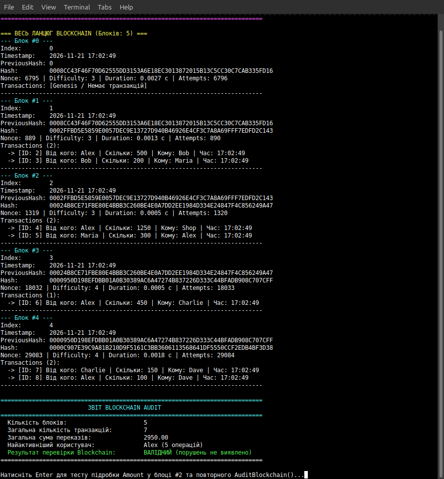
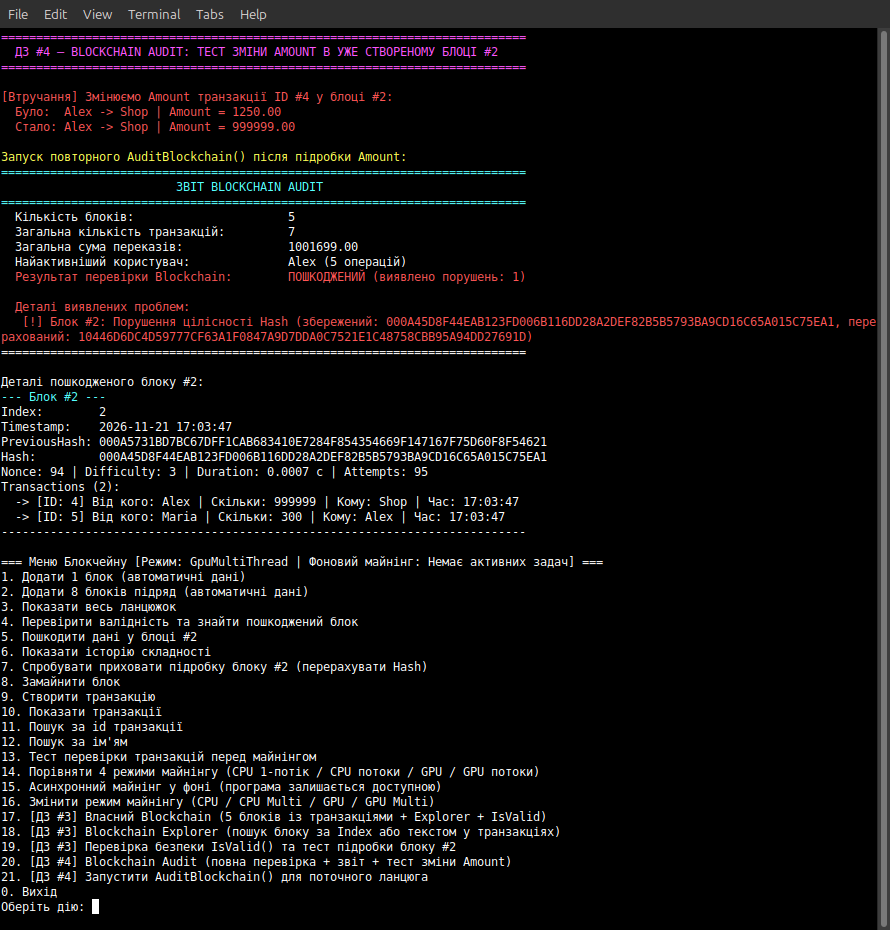

# ДЗ №4 — Blockchain Audit (`AuditBlockchain()`)

Реалізація повного аудиту блокчейну (`AuditBlockchain()`) на базі проєкту `BlockChainP33` (C# / .NET 10).

---

## Реалізований функціонал (Рівень 3 — Blockchain Audit)

У класі [`BlockChain`](../BlockChain.cs) створено метод **`AuditBlockchain()`**, який виконує комплексну перевірку всього ланцюга:
1. **Перевірка `Hash` кожного блоку** — перераховує SHA-256 хеш блоку та порівнює зі збереженим значенням.
2. **Перевірка правильності `PreviousHash`** — звіряє `PreviousHash` кожного блоку з `Hash` попереднього блоку.
3. **Перевірка валідності усіх транзакцій** — валідує кожну транзакцію через `TransactionService.ValidateTransaction(tx)` (відправник, отримувач, коректна сума > 0).
4. **Перевірка відсутності дублювання `Transaction Id` у різних блоках** — відстежує всі `tx.Id` по ланцюгу і виявляє повторення із зазначенням номера блоку, де цей ID вже зустрічався.
5. **Детальна діагностика замість простого `true/false`** — для кожного порушення виводиться **номер блоку** та **конкретна причина проблеми**.
6. **Звіт Blockchain Audit:**
   - кількість блоків;
   - загальна кількість транзакцій;
   - загальна сума переказів;
   - користувач із найбільшою кількістю операцій;
   - результат перевірки Blockchain (`ВАЛІДНИЙ` або `ПОШКОДЖЕНИЙ` із переліком усіх виявлених проблем).

---

## Скріншоти реального виконання (`04_dz/`)

### 1. Повна перевірка валідного блокчейну та звіт `AuditBlockchain()`

### 2. Зміна `Amount` транзакції в уже створеному блоці #2 — `AuditBlockchain()` виявляє порушення цілісності

