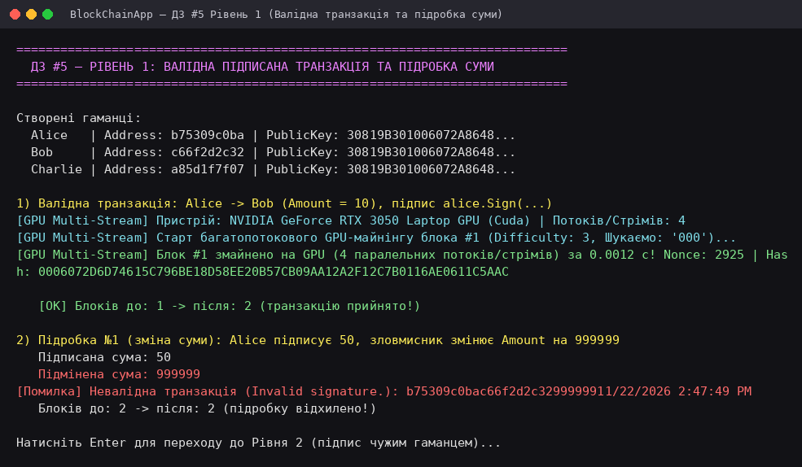
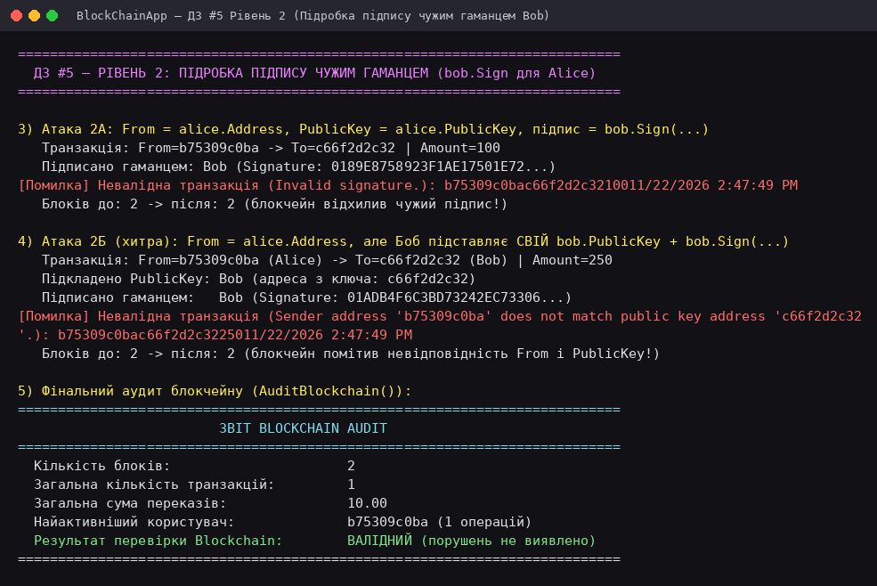

# ДЗ №5 — Криптографічний підпис транзакцій (ECDSA) та захист від підробки

Реалізація цифрових підписів транзакцій на базі **ECDSA + SHA-256** (`Wallet`, `WalletService`, `TransactionService`) та перевірка стійкості блокчейну до підробок у проєкті `BlockChainP33` (C# / .NET 10).

---

## Реалізований функціонал

### Рівень 1 — Повний приклад роботи підписів і відхилення підробки суми
1. Створюються криптографічні гаманці (`Alice`, `Bob`, `Charlie`) з парою ключів **ECDSA** (`PrivateKey`, `PublicKey`) та адресою `Address` (перші 10 hex-символів SHA-256 від `PublicKey`).
2. **Валідна транзакція:** `Alice -> Bob` на суму `10`, підписана `aliceWallet.Sign(tx.GetDataToSign())`, успішно проходить `ValidateTransaction()` та додається в блокчейн (`AddBlock`).
3. **Спроба підробки суми:** після підписання транзакції на `50` зловмисник змінює `Amount` на `999999`. При спробі додати її в блокчейн `VerifySignature()` повертає `false` — транзакція відхиляється з помилкою **`Invalid signature.`**, блок не створюється.

### Рівень 2 — Підробка підпису чужим гаманцем (`From = alice.Address`, підпис `bob.Sign(...)`)
Протестовано **обидва можливі сценарії** атаки чужим гаманцем:
1. **Атака 2А (чужий підпис при публічному ключі Alice):**
   - Створюється нова транзакція з `From = alice.Address`, `PublicKey = alice.PublicKey`, але підписується чужим гаманцем **`bob.Sign(tx.GetDataToSign())`**.
   - `WalletService.VerifySignature(...)` перевіряє підпис Боба публічним ключем Аліси та повертає `false` -> блокчейн відхиляє транзакцію (**`Invalid signature.`**).
2. **Атака 2Б (хитра підробка — чужий підпис + підміна `PublicKey = bob.PublicKey`):**
   - Зловмисник вказує `From = alice.Address`, але підставляє свій `PublicKey = bob.PublicKey` та підписує своїм `bob.Sign(...)`.
   - Без додаткової перевірки математично підпис Боба підійшов би до ключа Боба. Тому в [`WalletService.cs`](../Service/WalletService.cs) метод `GetAddress(byte[] publicKey)` зроблено публічним, а в [`TransactionService.cs`](../Service/TransactionService.cs) у `ValidateTransaction()` додано перевірку:
     ```csharp
     string expectedAddress = _walletService.GetAddress(transaction.PublicKey);
     if (!string.Equals(transaction.From, expectedAddress, StringComparison.OrdinalIgnoreCase))
     {
         return (false, $"Sender address '{transaction.From}' does not match public key address '{expectedAddress}'.");
     }
     ```
   - Блокчейн виявляє, що адреса з `PublicKey` (Боб) не збігається з `From` (Аліса), і **відхиляє підробку** ще до перевірки підпису.
3. **Фінальний аудит (`AuditBlockchain()`):** підтверджує, що жодна з 3 підроблених транзакцій не потрапила в ланцюг — блокчейн залишається **`ВАЛІДНИЙ`**.

---

## Як запустити демонстрацію
Запустити проєкт `dotnet run` та обрати пункт меню **`23`**:
```
23. [ДЗ #5] Цифровий підпис ECDSA: повний приклад + підробка суми + підпис чужим гаманцем
```

---

## Скріншоти реального виконання (`05_dz/`)

### 1. Рівень 1 — Валідна підписана транзакція та відхилення підробки суми (`Invalid signature.`)


### 2. Рівень 2 — Відхилення підробки підпису чужим гаманцем (`bob.Sign(...)` для `From = alice.Address`) та фінальний `AuditBlockchain()`

