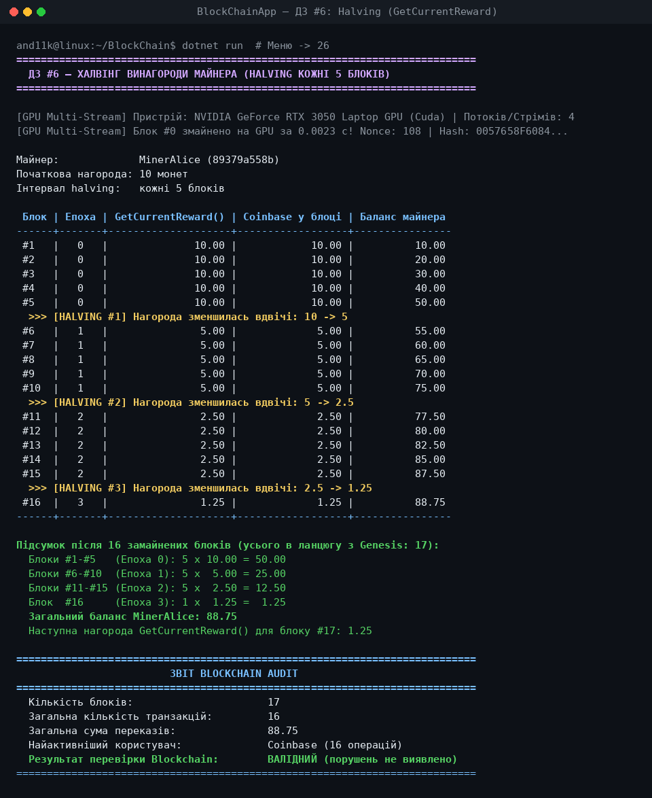

# ДЗ №6 — Халвінг винагороди майнера (`GetCurrentReward()`)

Реалізація механізму **halving** (зменшення винагороди майнера вдвічі кожні 5 блоків) та методу `GetCurrentReward()` у класі `BlockChain` проєкту `BlockChainP33` (C# / .NET 10).

---

## Реалізований функціонал

### 1. Параметри халвінгу та метод `GetCurrentReward()` у [`BlockChain.cs`](../BlockChain.cs)
- Додано інтервал халвінгу:
  ```csharp
  private readonly decimal _miningReward = 10; // Початкова нагорода за майнінг блоку
  public readonly int _halvingInterval = 5;    // Кількість блоків для зменшення нагороди вдвічі (halving)
  ```
- Реалізовано публічний метод **`GetCurrentReward()`**, який обчислює поточну нагороду залежно від кількості вже замайнених блоків (без урахування Genesis-блоку `#0`):
  ```csharp
  public decimal GetCurrentReward()
  {
      int minedBlocks = Math.Max(0, Chain.Count - 1);
      int halvings = minedBlocks / _halvingInterval;
      decimal reward = _miningReward;

      for (int i = 0; i < halvings; i++)
      {
          reward /= 2m;
          if (reward == 0m)
          {
              break;
          }
      }

      return reward;
  }
  ```

### 2. Використання динамічної нагороди під час майнінгу
- У методах **`AddBlock(...)`** та **`AddBlockAsync(...)`** Coinbase-транзакція тепер створюється з використанням `GetCurrentReward()` замість фіксованого `_miningReward`:
  ```csharp
  if (!string.IsNullOrWhiteSpace(minerAddress))
  {
      decimal currentReward = GetCurrentReward();
      transactionsCopy.Add(Transactions.CreateCoinbaseTransaction(minerAddress, currentReward));
  }
  ```
- У пункті меню `8` («Замайнити блок») відображається актуальна поточна нагорода `GetCurrentReward()` до майнінгу та наступна нагорода після додавання блоку.

### 3. Таблиця халвінгу (початкова нагорода = `10`, інтервал = `5` блоків)

| Блоки | Епоха (кількість halving) | Нагорода `GetCurrentReward()` | Сума за епоху | Накопичений баланс майнера |
|---|---:|---:|---:|---:|
| `#1 – #5` | `0` | **`10.00`** | `50.00` | `50.00` |
| `#6 – #10` | `1` (Halving #1) | **`5.00`** | `25.00` | `75.00` |
| `#11 – #15` | `2` (Halving #2) | **`2.50`** | `12.50` | `87.50` |
| `#16` | `3` (Halving #3) | **`1.25`** | `1.25` | **`88.75`** |

---

## Як запустити демонстрацію
Запустити проєкт `dotnet run` та обрати пункт меню **`26`**:
```
26. [ДЗ #6] Халвінг винагороди майнера (GetCurrentReward() — зменшення вдвічі кожні 5 блоків)
```

---

## Скріншот реального виконання (`06_dz/`)


