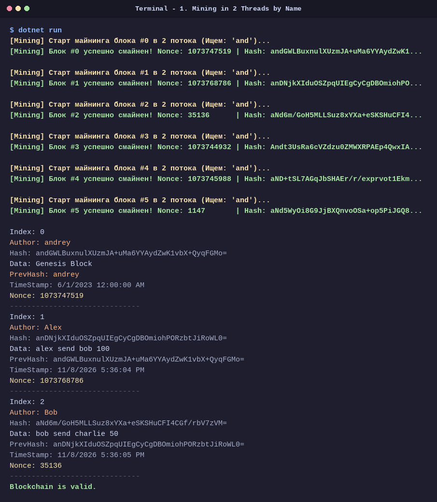
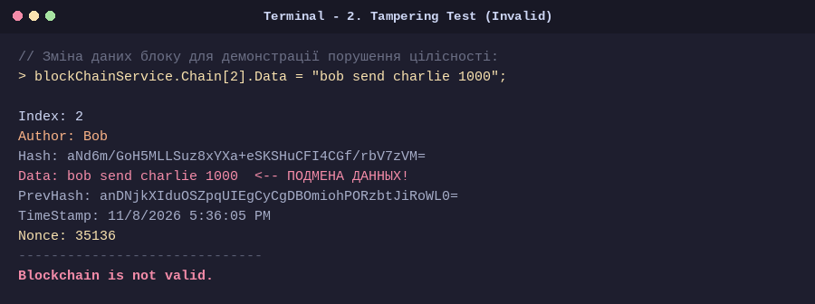

# Blockchain Implementation in C# (.NET)

Реалізація блокчейну з підтримкою авторів блоків, криптографічного Base64 хэшування (SHA-256), багатопоточного майнінгу Proof-of-Work та **механізму відновлення пошкодженого ланцюжка (`RepairChain`)**.

## Структура проекту

- **`Block.cs`** — модель блоку (`Index`, `Author`, `Data`, `PrevHash`, `TimeStamp`, `Nonce`, `Hash`).
- **`HashingService.cs`** — криптографічний сервіс обчислення SHA-256 хэшу блоку в Base64 форматі (`ComputeBlockHash`).
- **`MiningService.cs`** — багатопоточний майнінг (`Parallel.For` на 2 потоки) з пошуком цільового префіксу.
- **`BlockChain.cs`** — логіка блокчейну:
  - `AddGenesisBlock()` — створення початкового блоку;
  - `AddBlock(data, author)` — додавання нових блоків із майнінгом;
  - `IsChainValid()` — перевірка хешів, зв'язків `PrevHash` та префіксів майнінгу;
  - **`RepairChain(int startIndex)`** — повторний майнінг пошкодженого блоку та всіх наступних, відновлення цілісності `PrevHash` зі збором детальної статистики (кількість блоків, спроби, час).
- **`DisplayService.cs`** — сервіс виводу ланцюжка в консоль (`DisplayChain`).
- **`Program.cs`** — демонстраційний сценарій: додавання блоків, перевірка, навмисне пошкодження блоку #2 та відновлення через `RepairChain(2)`.

## Результати роботи програми (Скриншоти)

Скриншоти збережено в папці [`01_dz/`](./01_dz):

1. **Початковий стан та валідація:**  
   

2. **Виявлення пошкодження (невалідний блокчейн):**  
   

3. **Відновлення ланцюжка через `RepairChain(2)`:**  
   

## Запуск проекту

```bash
dotnet build
dotnet run
```
