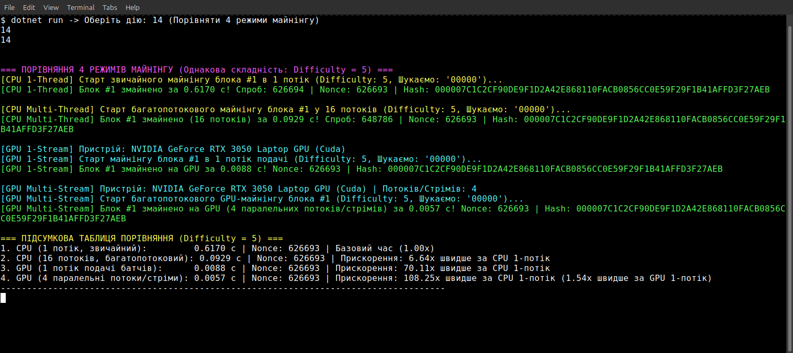
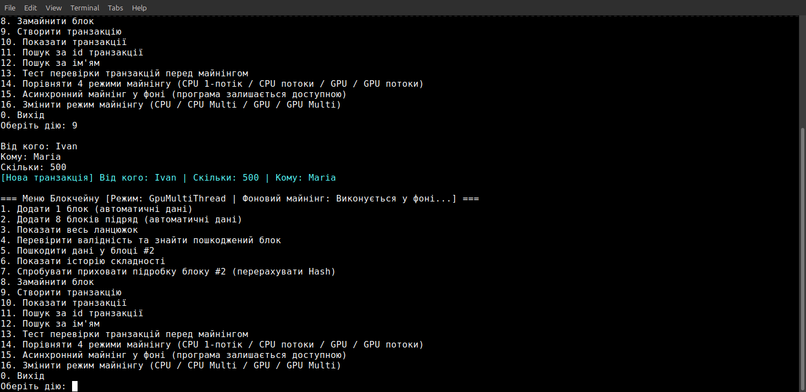
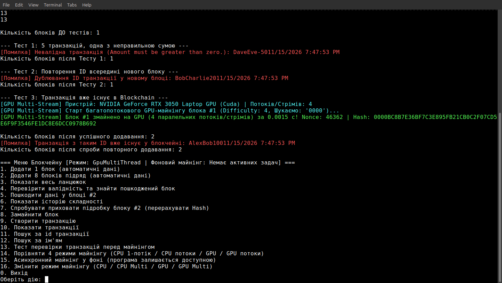
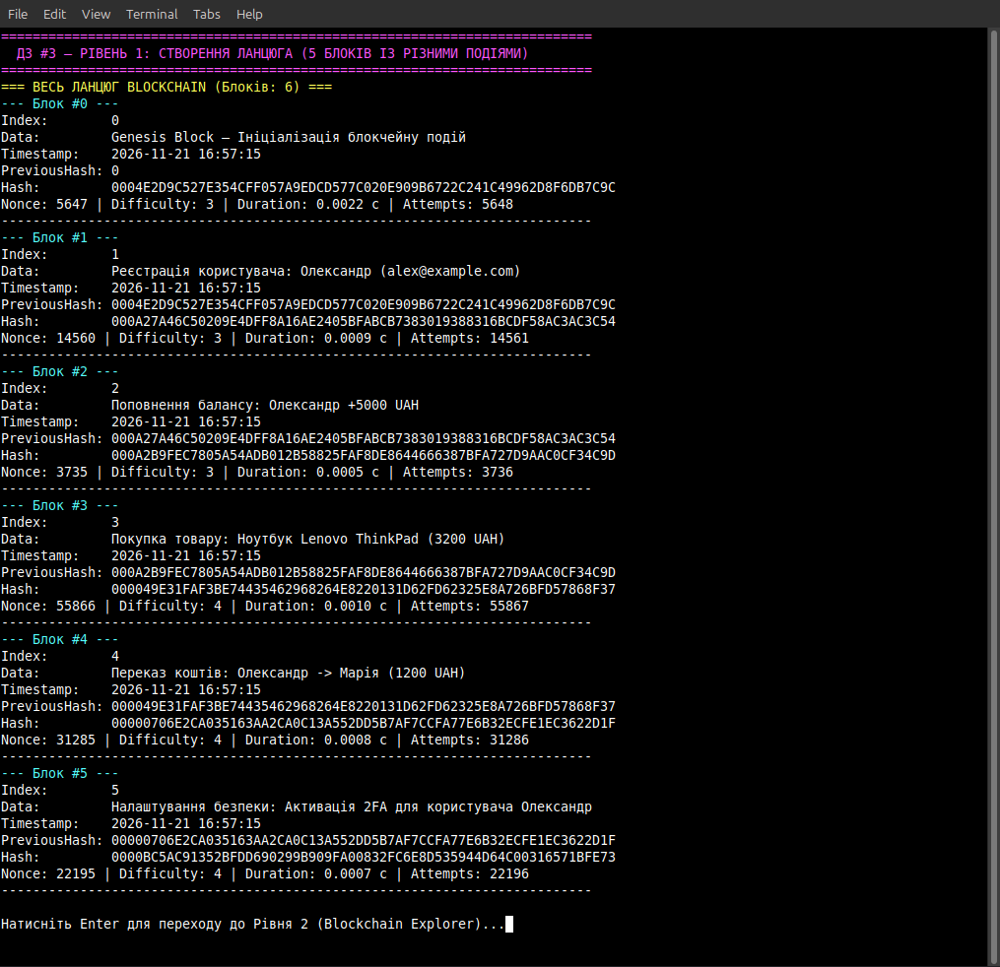
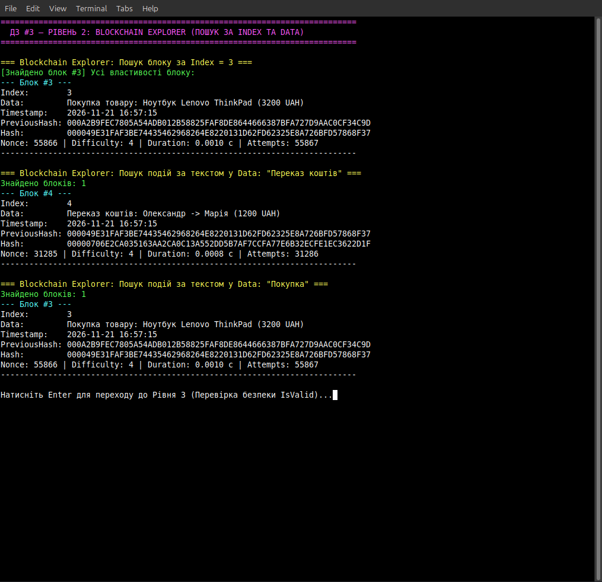
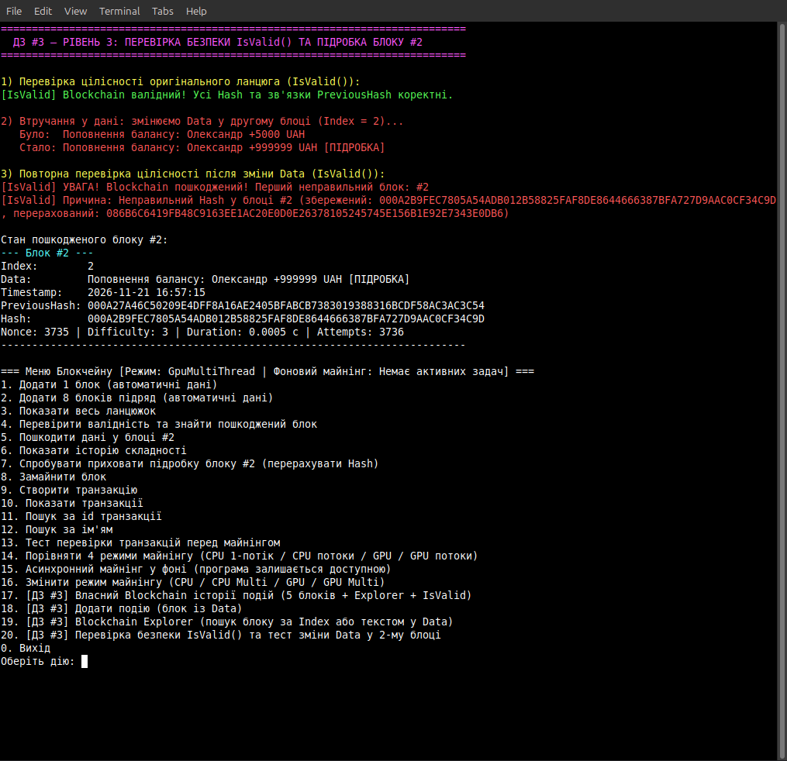

# Blockchain Implementation in C# (.NET 10) — Асинхронний та багатопотоковий майнінг (CPU & GPU CUDA)

Реалізація блокчейну на C# з підтримкою транзакцій (`Models.Transactions`), перевіркою цілісності блоків і транзакцій перед майнінгом, а також **асинхронним і багатопотоковим майнінгом Proof-of-Work (SHA-256)** у **4 режимах** (CPU 1-потік, CPU 16-потоків, GPU 1-стрім, GPU 4 паралельні стріми).

---

## Обладнання тестового стенду
- **Процесор (CPU):** 12th Gen Intel® Core™ i7-12650H (10 ядер / 16 логічних потоків)
- **Відеокарта (GPU):** NVIDIA GeForce RTX 3050 Laptop GPU (CUDA через ILGPU)
- **Складність для порівняння (`Difficulty`):** `5` (пошук хешу, що починається з `'00000'`, цільовий `Nonce = 626693`, хеш: `000007C1C2CF90DE9F1D2A42E868110FACB0856CC0E59F29F1B41AFFD3F27AEB`)

---

## Звіт: Асинхронний та багатопотоковий майнінг (4 варіанти)

### 1. Просто через процесор (CPU 1 потік — звичайний майнінг)
- **Принцип роботи (`MineBlockCpuSingleThread`):** Один потік послідовно перебирає `Nonce` від `0` до `int.MaxValue` (`0, 1, 2, 3...`), обчислюючи SHA-256 для кожного значення, поки не знайде хеш із потрібною кількістю нулів.
- **Час виконання (Difficulty = 5):** **`0.6170 с`** (перевірено `626 694` значень Nonce, знайдено `Nonce = 626693`).

### 2. Через процесор з багатопоточністю (CPU 16 потоків)
- **Принцип роботи (`MineBlockCpuMultiThread`):** Запускається `16` паралельних потоків (`Environment.ProcessorCount`). Кожен потік з індексом `threadId` перевіряє свій власний діапазон значень з кроком `16`: `threadId, threadId + 16, threadId + 32...`. Коли будь-який потік знаходить валідний хеш, він записує `winningNonce`, і всі інші потоки миттєво зупиняються (`Volatile.Read(ref winningNonce) != int.MaxValue`).
- **Час виконання (Difficulty = 5):** **`0.0929 с`** (`Nonce = 626693`).
- **Прискорення:** у **`6.64x` разів швидше** за звичайний однопотоковий майнінг на процесорі.

### 3. Через відеокарту (GPU 1 потік подачі батчів)
- **Принцип роботи (`MineBlockGpuSingleThread`):** Обчислення SHA-256 виконуються безпосередньо на ядрах відеокарти **NVIDIA GeForce RTX 3050 Laptop GPU (CUDA)** через кастомне ядро `Sha256GpuKernel`, але подача батчів (`65 536` значень за виклик) відбувається послідовно з одного потоку з очікуванням `Synchronize()` після кожного батчу.
- **Час виконання (Difficulty = 5):** **`0.0088 с`** (`Nonce = 626693`).
- **Прискорення:** у **`70.11x` разів швидше** за однопотоковий CPU та у **`10.56x` разів швидше** за 16-потоковий CPU.

### 4. Через відеокарту з потоками (GPU + 4 паралельні потоки / CUDA-стріми)
- **Принцип роботи (`MineBlockGpuMultiThread`):** Кілька паралельних потоків CPU одночасно створюють незалежні апаратні черги відеокарти (`AcceleratorStream`) і паралельно завантажують великі діапазони `Nonce` (по `524 288` значень на кожен стрім). Як тільки один зі стрімів знаходить хеш (`Atomic.Min` на GPU), решта потоків негайно зупиняються.
- **Час виконання (Difficulty = 5):** **`0.0057 с`** (`Nonce = 626693`).
- **Прискорення:** у **`108.25x` разів швидше** за звичайний CPU (1 потік) та у **`1.54x` разів швидше** за звичайний режим GPU (1 потік подачі).

---

## Порівняльна таблиця результатів (Difficulty = 5)

| № | Режим майнінгу | Пристрій / Потоки | Знайдений Nonce | Час майнінгу (с) | Прискорення (відносно CPU 1-потік) |
|---|---|---|---:|---:|---:|
| **1** | **Просто через процесор** | Intel Core i7-12650H (1 потік) | `626693` | **`0.6170 с`** | `1.00x` (базовий) |
| **2** | **Через процесор з багатопоточністю** | Intel Core i7-12650H (16 потоків) | `626693` | **`0.0929 с`** | **`6.64x` швидше** |
| **3** | **Через відеокарту (звичайний)** | RTX 3050 Laptop GPU (1 стрім) | `626693` | **`0.0088 с`** | **`70.11x` швидше** |
| **4** | **Через відеокарту з потоками** | RTX 3050 Laptop GPU (4 паралельні стріми) | `626693` | **`0.0057 с`** | **`108.25x` швидше** |

---

## Асинхронний майнінг (`MineBlockAsync` / `AddBlockAsync`)
Завдяки асинхронній обгортці `MineBlockAsync` та `AddBlockAsync` пошук хешу виконується у фоновому `Task`, не блокуючи головний потік консольного інтерфейсу. Під час роботи фонового майнінгу користувач може вільно переглядати меню, створювати нові транзакції та шукати дані в блокчейні.

---

## Скріншоти реального виконання (`02_dz/`)

### 1. Порівняння всіх 4 режимів майнінгу (CPU 1-Thread, CPU 16-Threads, GPU 1-Stream, GPU 4-Streams)

### 2. Асинхронний майнінг у фоні (програма залишається доступною під час пошуку хешу)

### 3. Перевірка списку транзакцій перед початком майнінгу в `AddBlock()`

---

## Короткий висновок
1. **Чи вдалося прискорити?** Так, багатопотоковий майнінг на процесорі (`16 потоків`) прискорив пошук хешу за однакової складності (`Difficulty = 5`) у **6.64 разів** (`0.0929 с` проти `0.6170 с` на одному потоці), оскільки кожен потік паралельно перевіряє власні значення `Nonce` і миттєво зупиняється, коли один із потоків знаходить рішення.
2. Перенесення обчислень SHA-256 на відеокарту (**NVIDIA GeForce RTX 3050 Laptop GPU**) дало прискорення у **70.11 разів** (`0.0088 с`), а поєднання відеокарти з паралельними потоками/CUDA-стрімами дозволило досягти максимального прискорення у **108.25 разів** (`0.0057 с`).
3. Використання асинхронного майнінгу (`async/await` + фоновий `Task`) дозволило залишити програму повністю інтерактивною та доступною для користувача під час пошуку хешу.

---

## ДЗ №3 — Власний Blockchain для збереження історії подій (`03_dz/`)
Детальний опис та скріншоти виконання див. у [03_dz/README.md](03_dz/README.md):
- **Рівень 1 (Створення ланцюга):** 5 блоків із різними подіями (`Index`, `Data`, `Timestamp`, `PreviousHash`, `Hash`) та вивід усього ланцюга у консоль.
- **Рівень 2 (Blockchain Explorer):** пошук блоку за `Index` (`FindBlockByIndex`) та пошук подій за текстом у `Data` (`SearchBlocksByData`) із показом усіх властивостей блоку.
- **Рівень 3 (Перевірка безпеки):** метод `IsValid()` перевіряє `Hash` кожного блоку та зв'язок через `PreviousHash`, виявляє пошкодження після зміни `Data` у блоці `#2` та виводить номер першого неправильного блоку.

